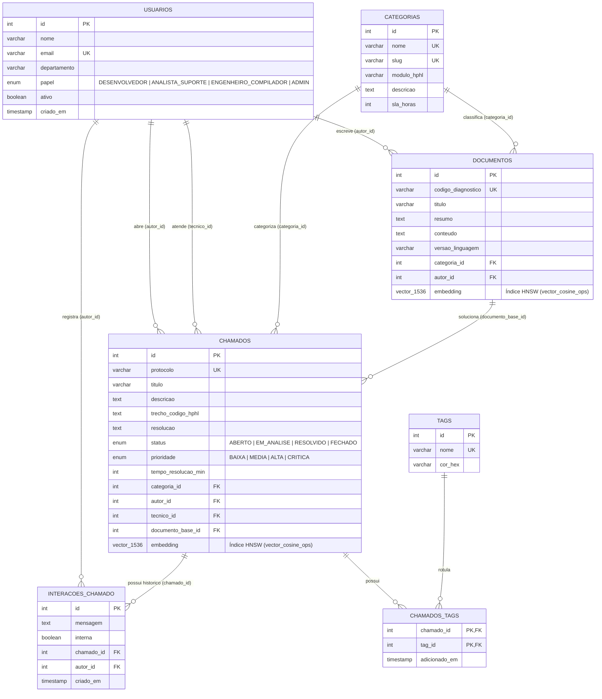

# 🧠 Smart-Base: Catálogo de Conhecimento & Helpdesk Semântico HP-HL

**Disciplina:** Banco de Dados e Modelos de Gerenciamento  
**Professor:** Willen Leolatto Carneiro  
**Trilhas Implementadas:** **Trilha A (Prisma ORM Avançado)** + **Trilha C (IA e Semântica / RAG com `pgvector` 1536d)** + **Coprocessador Nativo em HP-HL**

---

## 📚 Índice da Documentação Oficial do Projeto

| Documento | Descrição |
| :--- | :--- |
| 📄 **[`README.md`](./README.md)** | Manual de execução passo a passo, Diagrama DER (Mermaid) e visão geral do projeto. |
| 🤖 **[`IA_LOG.md`](./IA_LOG.md)** | **Relatório de Auditoria de IA** (Seção 6.4 do Edital): prompts utilizados e adaptações manuais da dupla. |
| 📘 **[`docs/DICIONARIO_DE_DADOS_E_NORMALIZACAO.md`](./docs/DICIONARIO_DE_DADOS_E_NORMALIZACAO.md)** | Justificativa de Normalização (**1FN, 2FN e 3FN**), Dicionário de Dados das 7 tabelas e Índices **HNSW / B-Tree**. |
| 🧠 **[`docs/ARQUITETURA_RAG_E_HPHL.md`](./docs/ARQUITETURA_RAG_E_HPHL.md)** | Arquitetura do fluxo RAG com `pgvector` (1536d), consultas SQL comentadas e integração com o Coprocessador Nativo **HP-HL**. |
| 🎤 **[`docs/ROTEIRO_APRESENTACAO.md`](./docs/ROTEIRO_APRESENTACAO.md)** | Roteiro prático de apresentação dividido entre os dois integrantes da dupla. |

---

## 🎯 1. Objetivo e Visão Geral do Projeto

O **Smart-Base (HP-HL SmartDiag)** é um MVP de backend e camada de persistência de dados projetado para gerenciar o **Catálogo de Conhecimento Corporativo (`documentos`)** e o **Sistema de Helpdesk (`chamados`)** do ecossistema da linguagem de programação compilada **HP-HL** (*High Performance and High Level Language*).

O sistema resolve um problema real de engenharia de software e suporte técnico:
1. **Persistência Relacional Estruturada (3FN) & Transações ACID (Trilha A):** Gerencia usuários (`usuarios`), categorias técnicas (`categorias`), artigos oficiais de diagnóstico (`documentos`), tickets de suporte (`chamados`), histórico de interações (`interacoes_chamado`) e classificação N:N (`tags` / `chamados_tags`) via **Prisma ORM**.
2. **Recuperação Semântica por Contexto e Fluxo de RAG (Trilha C):** Utiliza o **PostgreSQL 16** com a extensão **`pgvector`** armazenando vetores densos normalizados de **1536 dimensões** (`vector(1536)`) indexados com **HNSW** (`vector_cosine_ops`). Isso permite que uma busca como *"Esqueci minha senha e não consigo entrar"* encontre imediatamente o artigo e o chamado resolvido sobre *"Recuperar acesso após bloqueio de credencial"*, ou que o relato *"Programa fecha quando duas threads criam listas"* recupere o diagnóstico do bug `0xC0000374` do Garbage Collector da HP-HL.
3. **Coprocessador Nativo em HP-HL (`hphl/smartdiag_engine.hphl`):** Um motor compilado diretamente para código de máquina nativo x86_64 pelo compilador `hphlc` que realiza a triagem semântica em **~370 microssegundos (`0.37 ms`)** e executa benchmarks vetoriais sobre 5.000 vetores de 1536 dimensões.

---

## 🗂️ 2. Modelagem de Banco de Dados (DER)



---

## ⚙️ 3. Pré-Requisitos

- **Node.js:** versão 22 a 24 (testado em `v24.14.1`)
- **Docker & Docker Compose:** para subir o PostgreSQL 16 (`pgvector/pgvector:pg16`) e o `pgAdmin 4`
- **Git:** para controle de versão
- *(Opcional)* **Compilador HP-HL (`hphlc.exe`):** se presente na máquina, recompila `hphl/smartdiag_engine.hphl`; caso contrário, o sistema utiliza o binário pré-compilado ou o modo portátil em Node.js automaticamente.

---

## 🚀 4. Manual de Execução Passo a Passo

### Passo 1: Clonar o repositório e instalar as dependências
```bash
npm install
```

### Passo 2: Configurar as variáveis de ambiente
O arquivo `.env.example` já contém a configuração padrão pronta para o Docker:
```bash
cp .env.example .env
```

### Passo 3: Subir a infraestrutura no Docker (PostgreSQL 16 + pgvector + pgAdmin 4)
```bash
docker-compose up -d
```
- **PostgreSQL 16 + pgvector:** disponível em `localhost:5432` (`smartbase_db`)
- **pgAdmin 4:** disponível em `http://localhost:5050` (Login: `admin@smartbase.com` / Senha: `admin123` — o servidor já vem pré-registrado automaticamente via `docker/pgadmin-servers.json`).

### Passo 4: Executar as migrações do Prisma ORM (Trilha A + Criação dos Índices Vetoriais HNSW)
```bash
npx prisma migrate dev
```

### Passo 5: Popular o Banco de Dados com 5.000 Chamados + Artigos + Vetores de 1536 Dimensões (Seeder)
```bash
node src/seed.js
```
> O seeder insere as 7 categorias, 8 usuários, 8 tags, 7 artigos oficiais da documentação HP-HL (`documentos`) e **5.000 chamados de suporte (`chamados`)** acompanhados de seus vetores normalizados de 1536 dimensões.

### Passo 6: Executar as Buscas Semânticas e o Fluxo de RAG (Trilha C)

1. **Busca Semântica Vetorial (4 cenários de teste automáticos):**
   ```bash
   node src/search.js
   ```
   Ou pesquisando qualquer frase personalizada:
   ```bash
   node src/search.js "esqueci minha senha e preciso recuperar meu acesso"
   ```

2. **Pipeline Completo de RAG (Retrieval-Augmented Generation):**
   ```bash
   node src/rag.js "Meu programa fecha com erro 0xC0000374 quando duas tasks alocam strings em paralelo"
   ```

3. **Criação Estruturada e Transacional de Chamado (`prisma.$transaction`):**
   ```bash
   node src/create-ticket.js
   ```

4. **Demonstração Completa Unificada (Seed + Transação + RAG):**
   ```bash
   npm run demo
   ```

5. **Executar/Recompilar o Coprocessador Nativo em HP-HL (`hphl/smartdiag_engine.hphl`):**
   ```bash
   npm run hphl:build
   npm run hphl:benchmark
   ```

6. **Abrir a Interface Web Demonstrativa (Painel HTML Interativo):**
   ```bash
   npm run web
   ```
   Acesse no navegador: **`http://localhost:3000`**

---

## 📂 5. Estrutura de Arquivos do Projeto

```text
smart-base/
├── docker/
│   ├── init-db.sql                 # Script SQL inicial: CREATE EXTENSION IF NOT EXISTS vector;
│   └── pgadmin-servers.json        # Auto-registro do servidor PostgreSQL no pgAdmin 4
├── hphl/
│   ├── smartdiag_engine.hphl       # Código-fonte na linguagem HP-HL (triagem semântica & benchmark)
│   └── smartdiag_engine.exe        # Binário nativo x86_64 compilado pelo hphlc
├── prisma/
│   ├── schema.prisma               # Modelagem relacional 3FN + Unsupported("vector(1536)")
│   └── migrations/                 # Migração SQL versionada + Índices HNSW vector_cosine_ops
├── src/
│   ├── db.js                       # Conexão Prisma Client + Pool pg + Resiliência local
│   ├── hphl-bridge.js              # Ponte IPC entre Node.js e o executável nativo HP-HL
│   ├── embeddings.js               # Gerador de vetores densos de 1536 dimensões (norma L2 = 1.0)
│   ├── knowledge-catalog.js        # Artigos técnicos HP-HL, categorias, usuários e templates de massa
│   ├── seed.js                     # Seeder de 5.000 chamados + artigos + embeddings
│   ├── search.js                   # Busca por similaridade de cosseno (<=>) no pgvector
│   ├── rag.js                      # Fluxo completo de Retrieval-Augmented Generation
│   ├── create-ticket.js            # Criação transacional ACID ($transaction) com auto-triagem
│   └── index.js                    # Roteiro completo de demonstração para apresentação
├── .env.example                    # Modelo de variáveis de ambiente
├── .gitignore                      # Proteção de node_modules, .env e arquivos temporários
├── docker-compose.yml              # Orquestração PostgreSQL 16 (pgvector) + pgAdmin 4
├── IA_LOG.md                       # Relatório de Auditoria de Prompts e Adaptações Manuais
└── README.md                       # Manual de Execução e Documentação Arquitetural
```
