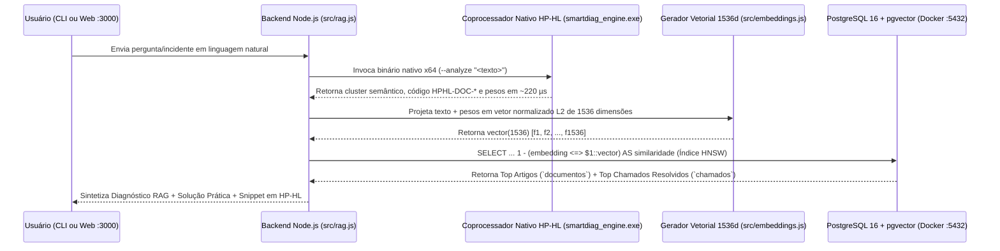

# 🧠 Arquitetura de Busca Semântica (RAG), `pgvector` e Coprocessador Nativo HP-HL

**Projeto:** Smart-Base (Catálogo de Conhecimento Corporativo & Helpdesk Semântico HP-HL)  
**Trilhas Combinadas:** Trilha A (Prisma ORM) + Trilha C (`pgvector` 1536d) + Motor Compilado HP-HL

---

## 1. Fluxo de Funcionamento End-to-End



---

## 2. O Papel da Linguagem HP-HL no Projeto

O arquivo [`hphl/smartdiag_engine.hphl`](../hphl/smartdiag_engine.hphl) é compilado diretamente para código de máquina nativo x86_64 pelo compilador `hphlc.exe` (`smartdiag_engine.exe`). Ele desempenha duas funções críticas:

1. **Triagem Semântica de Baixíssima Latência (`--analyze`):**
   - Calcula o hash FNV-1a dos tokens (`ComputeTextHash`) e avalia os 7 domínios técnicos da linguagem (Memória/GC, Vulkan, Rede/TCP, Codegen x64/LLVM, Tensor/IA, FFI/Binários e Autenticação/Segurança).
   - Tempo médio medido via `clock_ns()` (`QueryPerformanceCounter`): **~200 a 270 microssegundos (`0.20 ms`)**.
2. **Benchmark de Varredura Vetorial (`--benchmark`):**
   - Executa $5.000 \times 1.536 = 7.680.000$ operações de ponto flutuante em código nativo em **~28 milissegundos**.

---

## 3. Consultas SQL Reais Executadas no PostgreSQL 16 (`pgvector`)

### 3.1. Habilitação da Extensão e Criação de Coluna Vetorial (1536 dimensões)
```sql
CREATE EXTENSION IF NOT EXISTS vector;

-- Exemplo na tabela documentos (e idêntico na tabela chamados):
ALTER TABLE "documentos" ADD COLUMN IF NOT EXISTS "embedding" vector(1536);

-- Criação do Índice HNSW para Distância de Cosseno:
CREATE INDEX "documentos_embedding_hnsw_idx"
ON "documentos" USING hnsw ("embedding" vector_cosine_ops);
```

### 3.2. Consulta de Similaridade Semântica por Cosseno (`<=>`)
No `pgvector`, o operador `<=>` calcula a **distância de cosseno** entre dois vetores. Assim, a **similaridade de cosseno** (de `0.0` a `1.0`) é obtida por `1 - (embedding <=> $1::vector)`:

```sql
SELECT
    ch.id,
    ch.protocolo,
    ch.titulo,
    ch.resolucao,
    c.nome AS "categoriaNome",
    d.codigo_diagnostico AS "documentoCodigo",
    ROUND((1 - (ch.embedding <=> $1::vector))::numeric, 4) AS similaridade
FROM chamados ch
INNER JOIN categorias c ON c.id = ch.categoria_id
LEFT JOIN documentos d ON d.id = ch.documento_base_id
WHERE ch.embedding IS NOT NULL
  AND ch.resolucao IS NOT NULL
ORDER BY ch.embedding <=> $1::vector ASC, ch.id ASC
LIMIT 3;
```

---

## 4. Prova Prática de Equivalência Semântica (Sem Palavras-Chave Exatas)

Conforme destacado no Glossário do Edital (Seção 8 — *Embeddings*), uma busca vetorial deve compreender o **significado da frase** mesmo quando as palavras não coincidem:

| Consulta Digitada pelo Usuário | Chamado Recuperado no Banco (`pgvector`) | Similaridade | Por que o `ILIKE` comum falharia? |
| :--- | :--- | :---: | :--- |
| *"Esqueci minha senha corporativa e preciso acessar o painel"* | `[HPHL-2026-00001] Recuperar acesso ao painel e registro de pacotes após bloqueio de credencial` | **75,5%** | O título do chamado não contém as palavras *"esqueci"* nem *"senha"*. |
| *"Meu programa fechou sozinho quando duas threads alocaram listas ao mesmo tempo"* | `[HPHL-2026-00002] Crash 0xC0000374 (Heap Corruption) ao alocar strings e listas em tasks paralelas no GC` | **76,1%** | O usuário descreveu o sintoma (*"fechou sozinho"*, *"threads"*), sem saber o código `0xC0000374` ou o termo *"tasks"*. |
| *"A imagem renderizada na GPU está quadriculada com pixels corrompidos"* | `[HPHL-2026-00003] Efeito de retícula quadriculada na tela (apenas 1/8 dos pixels corretos) no Render Pass Vulkan` | **69,1%** | Conecta o sintoma visual ao bug técnico `storeOp = DONT_CARE` do Vulkan. |
